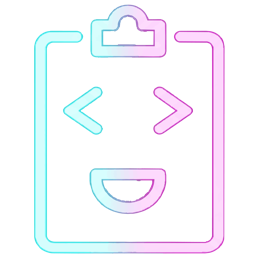

# Pasteboard

<p align="center"></p>

Pasteboard is a compact, typing-first note surface for VS Code. It opens from a right-aligned Status Bar item, keeps your current draft in focus, and saves automatically while you type.

## Screenshots

### Editor view


### Sidebar view


## What you’ll see

- A **Pasteboard** Status Bar item in the bottom-right corner — highlighted while Pasteboard is open, plain when it's closed. Click to toggle.
- A compact editor with a subtle, theme-aware border.
- Search and saved-note history at the bottom of the view.
- Inline SVG toolbar buttons for autosave, new note, pin, duplicate, save, and panel toggle.
- Save status changes to “Saved” only after the extension host confirms persistence; failed writes are surfaced.
- Switching notes or scopes flushes the current autosaved draft. With autosave disabled, Pasteboard asks whether to save or discard edits before navigation.
- Hover-reveal delete controls for each saved item, with a few-seconds "Undo" toast after deleting.
- Tab pills show a live item count per workspace/GLOBAL scope.

## Placement behavior

Pasteboard prefers a compact right-side experience, but VS Code does not expose a reliable API to force an exact pixel width or a specific side for every view.

The extension uses the following behavior:

1. The primary experience is a sidebar WebviewView, which is narrow and compact by default.
2. When the view is opened from the Status Bar, it tries to reveal the built-in view container and keep the experience compact.
3. If the user prefers the fallback panel experience, the extension opens a compact WebviewPanel beside the editor and nudges the layout smaller using the built-in view-size commands.
4. The last chosen placement is remembered in global state and reused on the next toggle.

If you prefer Right Sidebar placement, right-click the Pasteboard view title and choose Move View → Right. Pasteboard will remember that placement on future toggles.

## Quick capture

Beyond typing directly into the editor, there are three fast ways to get things into Pasteboard:

- **Add Selection to Pasteboard** — select text in any editor, then run the command (or right-click → "Add Selection to Pasteboard"). The new item is titled with the file and line range and saved immediately to the tab matching that file's workspace folder, without stealing focus from your editor. A quick notification with a "Show" button confirms the capture.
- **New Item from Clipboard** — creates a draft pre-filled with your clipboard's current text, ready to review/edit before it's saved.
- **Quick Open Item** (Ctrl/Cmd + Alt + O) — a searchable Quick Pick across every tab, including GLOBAL. Scales much better than scrolling the in-panel list once you have a lot of saved items.

## Commands

- Pasteboard: Toggle from Status Bar
- Pasteboard: Toggle Panel
- Pasteboard: New Item
- Pasteboard: Save Item
- Pasteboard: Delete Item
- Pasteboard: Open Global Tab
- Pasteboard: Set Default Placement
- Pasteboard: Add Selection to Pasteboard
- Pasteboard: New Item from Clipboard
- Pasteboard: Quick Open Item
- Pasteboard: Export Current Tab to Markdown — opens an unsaved Markdown document with every item in the active tab; use "Save As" to keep it.

## Keyboard shortcuts

- Ctrl/Cmd + Alt + P — Toggle Pasteboard
- Ctrl/Cmd + Alt + N — New item while Pasteboard is focused
- Ctrl/Cmd + Alt + S — Save item while Pasteboard is focused
- Ctrl/Cmd + Alt + Shift + P — Add the current editor selection to Pasteboard
- Ctrl/Cmd + Alt + O — Quick Open a saved item from any tab
- Delete or Backspace while a list item is focused — Delete that item (offers Undo)

## Settings

- pasteboard.autosave (default: true)
- pasteboard.autosaveDelay (default: 1000, clamped to 250-10000ms)
- pasteboard.confirmDelete (default: true)
- pasteboard.maxItems (default: 200)
- pasteboard.editorBorder (default: "1px")
- pasteboard.preferredWidthPercent (default: 25)
- pasteboard.sidebarMode (default: "view")
- pasteboard.openPanelOnStartup (default: false)
- pasteboard.storageMode (default: "state", or "file" for cross-IDE persistence)

Example:

```json
{
  "pasteboard.autosave": true,
  "pasteboard.autosaveDelay": 1000,
  "pasteboard.confirmDelete": true,
  "pasteboard.maxItems": 200,
  "pasteboard.editorBorder": "1px",
  "pasteboard.preferredWidthPercent": 25,
  "pasteboard.sidebarMode": "view",
  "pasteboard.storageMode": "state"
}
```

## Storage and migrations

Global notes are available across workspaces. Workspace notes are stored separately for each workspace folder. By default, notes are kept in VS Code's extension storage.

To share workspace notes across editor windows or compatible IDEs, set `pasteboard.storageMode` to `file`. Notes are then stored in `.vscode/pasteboard.json` inside each workspace folder. Commit that file to share notes with your team, or add it to `.gitignore` to keep it local.

Pasteboard migrates notes from older versions automatically. When the configured item limit is reached, it removes the oldest unpinned items first and notifies you if anything is removed.
